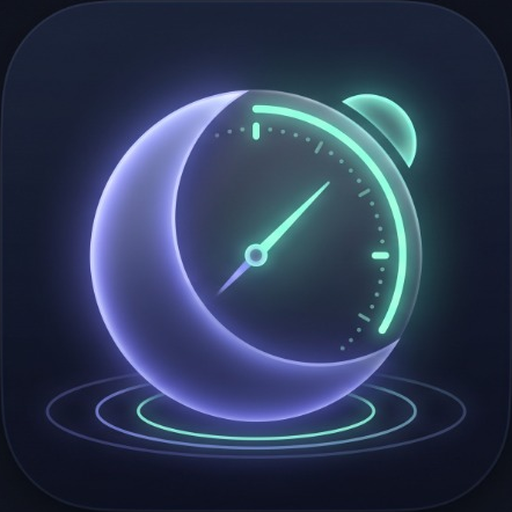

# 🔔 AlarmSimple

**Free and Open Source Smart Alarm Clock**  
*Real sleep tracking, smart wake-up during light sleep phases, nocturnal sound recorder, and wake-up quests.*

---

---

**AlarmSimple** is an ad-free, subscription-free, and tracker-free smart alarm clock. The app helps you wake up feeling refreshed by analyzing your sleep cycles and guarantees you get out of bed using wake-up verification tasks, volume lock, and a system backup alarm fuse.

---

## ✨ Features

### 1. Two Alarm Modes (Configurable)
* **Sleep Duration Mode:** Set how much sleep you need — from quick power naps (from 30 minutes) to full restorative sleep (7.5–10 hours). The app detects silence and stillness — the sleep timer starts **only after you actually fall asleep**.
* **Classic Mode:** A traditional alarm clock for a specific time (e.g., 7:00 AM) with flexible repeat options: **every week**, **every 2 weeks**, or **every 3 weeks**.
* **Sleep Cycle Warning:** If sleep duration is shorter than a full ultradian sleep cycle (~90 min), the app informs you that smart phase detection might not apply.

### 2. Smart Wake-Up Window
* Set a configurable time window (±15, ±20, ±30, or ±45 minutes).
* Within this window, the app detects the transition from deep sleep to light sleep (via movement and rustling) and begins playing a gentle, gradually increasing alarm sound.
* If no light phase is detected, the alarm triggers exactly at the target deadline.

### 3. Wake-Up Verification Tasks
When tasks are enabled, the normal "Dismiss" button is hidden — only a **"Give 5 Minutes"** button is available, which temporarily mutes the alarm:
* **NFC Tag:** Walk to another room and tap your phone to an NFC sticker.
* **Barcode:** Scan a chosen item with the camera (e.g., toothpaste in the bathroom). Camera permission is requested on-the-fly.
* **Math:** Solve 3 mental math problems (configurable difficulty; any timeout or mistake resets progress).

### 4. Reliability & Anti-Tamper Protection
* **Hardware Volume Lock:** Volume rocker keys are intercepted and locked at 100% during alarm firing.
* **System Backup Fuse:** A setting that automatically schedules a fallback native Android system alarm for +5 minutes later. If the phone reboots overnight or the app is killed, the native alarm ensures you still wake up. When AlarmSimple fires successfully, it cancels the backup alarm automatically.
* **Crash Session Recovery:** If the device shuts down or reboots mid-sleep, the unfinalized sleep session is automatically salvaged from the last recorded epoch upon boot.

### 5. Morning Statistics & Sleep Audio
* **Clear Hypnogram:** Night sleep stage visualization (Deep, Light, REM, Awake).
* **Night Sound Snippets:** Smart recording captures interesting audio events (snoring, sleep talking, coughing, strange noises) for morning playback.
* **Smart Media Filtering:** If you fall asleep watching videos or podcasts, the system recognizes continuous external audio and avoids false triggers.

---

## 🔒 Privacy & Battery Efficiency

* **100% Offline:** No `INTERNET` permission. Your sleep data and audio snippets never leave your device.
* **Storage Friendly:** No continuous 8-hour audio files. Only short 10–12 second clips are saved in compressed AAC format (~30 KB per clip).
* **Battery Conscious:** Hardware sensor batching and CPU partial sleep limits overnight battery drain to **~8–15% over 8 hours**.

---

## 🛠️ Tech Stack

* **Language:** Kotlin 2.1
* **UI:** Jetpack Compose + Material 3 (Dynamic Color & System Theme support)
* **Architecture:** Clean Architecture + MVVM
* **DI:** Dagger Hilt
* **Database:** Room Database
* **Preferences:** Jetpack DataStore Preferences
* **Barcode Scanner:** Google ML Kit Barcode Scanning + CameraX
* **Build System:** Gradle Version Catalogs (Kotlin DSL)
* **Min SDK:** Android 8.0 (API 26)
* **Target SDK:** Android 15 (API 35)

---

## 📄 License

This project is licensed under the **MIT License**. See the [LICENSE](LICENSE) file for details.
